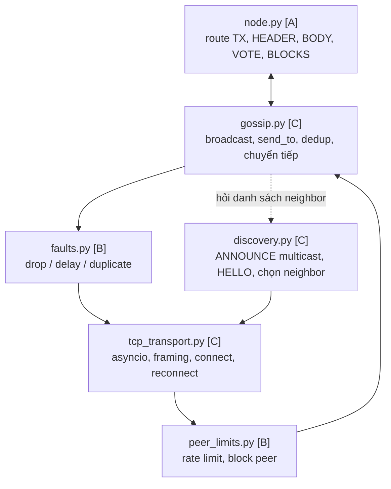

# Vai trò C: P2P Network

Tài liệu làm việc cho người giữ vai trò C. Đọc kèm [CONCEPT_GUIDE.md](CONCEPT_GUIDE.md), Tầng 3, và mục Interfaces trong [TEAM_PLAN.md](TEAM_PLAN.md).

**Phạm vi:** `src/l1sim/network/tcp_transport.py`, `discovery.py`, `gossip.py`, unit test của 3 file này, test end-to-end T2, D1, D2, và phần Network trong report.

**Không thuộc phạm vi C**, nhưng nằm sát bên cạnh: `faults.py` và `peer_limits.py` của B, `block_sync.py` của D, `node.py` của A. C chỉ cần biết chúng gọi vào mình ở đâu.

Các hàm ở đây là **dự đoán** dựa trên mục Interfaces của Team Plan. Chỗ nào đánh dấu **[cần chốt]** thì phải thống nhất với người liên quan trước khi code.

---

## Mục lục

1. [Bức tranh: C nằm ở đâu](#1-bức-tranh-c-nằm-ở-đâu)
2. [Kiến thức cần nắm trước](#2-kiến-thức-cần-nắm-trước)
3. [Lộ trình theo ngày](#3-lộ-trình-theo-ngày)
4. [Bước 0: Chuẩn bị](#bước-0-chuẩn-bị-2710)
5. [Bước 1: Thử multicast](#bước-1-thử-multicast-2810)
6. [Bước 2: TcpTransport](#bước-2-tcptransport-2729-10)
7. [Bước 3: HELLO handshake](#bước-3-hello-handshake-2829-10)
8. [Bước 4: Gossip](#bước-4-gossip-3010-0111)
9. [Bước 5: Discovery](#bước-5-discovery-3010-0211)
10. [Bước 6: Bảo trì neighbor](#bước-6-bảo-trì-neighbor-0203-11)
11. [Bước 7: Test end-to-end T2, D1, D2](#bước-7-test-end-to-end-t2-d1-d2-0204-11)
12. [Bước 8: Report](#bước-8-report-0305-11)
13. [Những lỗi hay gặp](#những-lỗi-hay-gặp)
14. [Checklist cuối](#checklist-cuối)

---

## 1. Bức tranh: C nằm ở đâu



**Chiều gửi:** node gọi `gossip.broadcast(msg)` → gossip lặp qua từng neighbor → `FaultInjector.decide()` quyết định số phận → `TcpTransport.send()` sau delay.

**Chiều nhận:** `TcpTransport` đọc đủ một frame → `PeerLimits.on_receive()` → gossip `decode`, kiểm tra `message_id` đã thấy chưa → gọi handler của node → chuyển tiếp cho neighbor khác.

Một câu để nhớ vai trò: **C lo cho mọi message đi tới được mọi node, mỗi node xử lý nó đúng một lần, và chỉ nói chuyện với validator thật.** C không quan tâm nội dung message là vote hay block.

---

## 2. Kiến thức cần nắm trước

### 2.1 asyncio (quan trọng nhất)

| Khái niệm | Cần biết gì | Dùng ở đâu |
|---|---|---|
| Event loop, `async def`, `await` | Một thread chạy nhiều coroutine xen kẽ; chỉ nhường chỗ ở `await` | Mọi thứ |
| `asyncio.start_server(cb, host, port)` | Mỗi kết nối đến gọi `cb(reader, writer)` | Nhận inbound |
| `asyncio.open_connection(host, port)` | Trả về `(reader, writer)` | Kết nối outbound |
| `reader.readexactly(n)` | Đọc đúng n bytes, ném `IncompleteReadError` khi bị đóng giữa chừng | Framing |
| `writer.write()` + `await writer.drain()` | `write` chỉ đẩy vào buffer, `drain` chờ buffer vơi | Gửi |
| `asyncio.create_task()` | Chạy song song một coroutine; **phải giữ tham chiếu** kẻo bị GC | Vòng đọc mỗi peer, beacon |
| `asyncio.Queue` | Hàng đợi giữa các coroutine | Hàng gửi của mỗi peer |
| `loop.call_later(delay, fn)` | Hẹn gọi hàm sau delay | Delay của fault injection, timeout |
| `asyncio.wait_for(coro, timeout)` | Giới hạn thời gian chờ | HELLO, connect |
| `loop.create_datagram_endpoint()` | Socket UDP trong asyncio | Multicast ANNOUNCE |

Nên đọc: tài liệu chính thức mục *Streams* và *Transports and Protocols* của `asyncio`.

### 2.2 TCP và framing

- TCP là **dòng bytes liên tục**, không có ranh giới message. Một lần `read` có thể nhận nửa message hoặc 2 message dính nhau.
- Framing: mỗi message = **4 bytes độ dài (big-endian, unsigned)** + nội dung. Dùng `struct.pack(">I", len(data))`.
- Phải có **giới hạn kích thước frame** (ví dụ 4 MB), nếu không một peer xấu gửi độ dài 4 GB là node cố cấp phát bộ nhớ tới chết.

### 2.3 UDP multicast

| Khái niệm | Ý nghĩa |
|---|---|
| Nhóm multicast `239.x.x.x` | Dải "administratively scoped", dùng nội bộ, không ra Internet |
| `IP_ADD_MEMBERSHIP` | Đăng ký nghe một nhóm trên một interface |
| `IP_MULTICAST_IF` | Chọn interface để **gửi**, bắt buộc khi chạy qua ZeroTier |
| `IP_MULTICAST_LOOP` | Cho phép process trên **cùng máy** nhận gói mình gửi, bắt buộc khi chạy 10 node trên 1 máy |
| `IP_MULTICAST_TTL` | Số router được đi qua; để 1 |
| `SO_REUSEADDR` + `SO_REUSEPORT` | Cho **nhiều process cùng bind một UDP port**; trên macOS bắt buộc có `SO_REUSEPORT` |

### 2.4 Gossip / flooding

- Gửi cho mọi neighbor; nhận được thì nếu **chưa thấy** mới xử lý và chuyển tiếp cho mọi neighbor **trừ người vừa gửi**.
- Dedup theo `message_id = sha256(encode(msg))`.
- Graph phải **connected**, nếu không sẽ có node không bao giờ nhận được message.
- Với 10 node, `target_degree` 4, đường kính graph khoảng 2–3 chặng.

### 2.5 Mật mã ở mức dùng được

Không cần tự viết, chỉ gọi hàm của A:

```python
sign(sk, "HELLO", obj) -> str
verify(pk, "HELLO", obj, sig) -> bool
```

Cần hiểu **vì sao** HELLO và ANNOUNCE phải ký: không ký thì một node bất kỳ có thể tự xưng là V3, chiếm chỗ neighbor của V3 và nuốt mất message.

### 2.6 Determinism (Tầng 5)

Những chỗ C dễ làm hỏng T8:

- Duyệt `set` hoặc `dict` của neighbor mà không `sorted()`.
- Chọn neighbor theo thứ tự ai trả lời ANNOUNCE trước.
- Dùng `random` ở bất kỳ đâu.

Quy tắc: **mọi danh sách peer trả ra ngoài đều sorted**; mọi lựa chọn đều là hàm của `seed` và `node_id`.

---

## 3. Lộ trình theo ngày

Bám theo timeline trong Team Plan.

| Ngày | Việc | Gate |
|---|---|---|
| 27/10 | Bước 0, bắt đầu Bước 2 với framing | |
| 28/10 | **Bước 1: thử multicast trên máy cả nhóm và qua ZeroTier**; Bước 2 tiếp | |
| 29/10 | Bước 2 xong, Bước 3 HELLO | **Gate: 2 node HELLO qua TCP, unit test pass** |
| 30/10–01/11 | Bước 4 gossip; song song Bước 5 discovery | **Gate 01/11: T1 pass 10 node** (dùng stub discovery) |
| 02–03/11 | Bước 5 xong, bật discovery mặc định; Bước 6 bảo trì neighbor | |
| 02–04/11 | Bước 7: T2, D1, D2 | **Gate 04/11: mọi test pass** |
| 03–05/11 | Bước 8: viết report | |

Ưu tiên khi trễ: **TcpTransport > Gossip > HELLO > Discovery multicast > bảo trì neighbor.** A cần transport và gossip để ghép T1; discovery có thể chạy bằng stub (danh sách địa chỉ cố định) tới khi xong.

---

## Bước 0: Chuẩn bị (27/10)

- [ ] Đọc Concept Guide Tầng 3 toàn bộ, Tầng 5 mục "Những thứ phá determinism".
- [ ] Đọc mục Interfaces trong Team Plan, đặc biệt phần `network (C)` và sơ đồ "Một message đi qua các lớp".
- [ ] Tạo issue trên GitHub cho từng step, branch theo `CONTRIBUTING.md`, ví dụ `feat/<issue>-tcp-transport`.
- [ ] Tạo thư mục `src/l1sim/network/` với `__init__.py`.
- [ ] Hỏi A khi nào có `encoding.py`, `crypto.py`, `types.py`. Trước khi có, viết **stub** tạm:

```python
# tạm thời, xóa khi A merge
def encode(obj) -> bytes: return json.dumps(obj, sort_keys=True, separators=(",", ":")).encode()
def decode(data: bytes): return json.loads(data)
def message_id(msg) -> str: return hashlib.sha256(encode(msg)).hexdigest()
```

**[cần chốt] với A**, ghi lại trong `docs/DESIGN.md`:

1. `TcpTransport.connect()` trả `node_id` "sau HELLO", nhưng constructor không có keypair hay genesis. Đề xuất: transport nhận một **hàm handshake** do Discovery cung cấp, để transport không phải biết về chữ ký.
2. HELLO là `Message(kind="HELLO")` gửi qua cùng framing, hay một frame riêng? Đề xuất: cùng framing, là frame **đầu tiên** của mỗi kết nối.
3. Ai giữ `FaultInjector` và `PeerLimits`: gossip gọi trực tiếp, hay node truyền vào hàm `sender`? Interface hiện có tham số `sender` trong `Gossip.__init__`, nên đề xuất: **node dựng `sender` đã bọc FaultInjector**, gossip chỉ gọi `sender(peer_id, msg)`.

---

## Bước 1: Thử multicast (28/10)

**Mục tiêu:** chắc chắn multicast chạy được trên **máy của cả 4 người** và giữa laptop với homelab qua ZeroTier. Không có bootstrap node, nên nếu multicast không chạy thì discovery chết hẳn. Đây là rủi ro lớn nhất của vai trò C, phải biết sớm.

A đã có `scripts/mcast_test.py` đo qua ZeroTier. Việc của C là bản **tối giản 2 process trên 1 máy**, để từng người chạy thử:

```python
# scripts/mcast_pingpong.py --name X [--iface 0.0.0.0]
GROUP, PORT = "239.1.1.1", 9999

def make_socket(iface: str) -> socket.socket:
    s = socket.socket(socket.AF_INET, socket.SOCK_DGRAM, socket.IPPROTO_UDP)
    s.setsockopt(socket.SOL_SOCKET, socket.SO_REUSEADDR, 1)
    if hasattr(socket, "SO_REUSEPORT"):
        s.setsockopt(socket.SOL_SOCKET, socket.SO_REUSEPORT, 1)
    s.bind(("", PORT))
    mreq = socket.inet_aton(GROUP) + socket.inet_aton(iface)
    s.setsockopt(socket.IPPROTO_IP, socket.IP_ADD_MEMBERSHIP, mreq)
    s.setsockopt(socket.IPPROTO_IP, socket.IP_MULTICAST_IF, socket.inet_aton(iface))
    s.setsockopt(socket.IPPROTO_IP, socket.IP_MULTICAST_LOOP, 1)
    s.setsockopt(socket.IPPROTO_IP, socket.IP_MULTICAST_TTL, 1)
    return s
# mỗi giây gửi f"hello from {name}", in mọi gói nhận được
```

- [ ] Chạy 2 terminal trên máy mình: thấy gói của nhau.
- [ ] Gửi script cho B, D, A chạy trên máy họ; ghi lại OS và kết quả.
- [ ] Chạy qua ZeroTier với `--iface <IP ZeroTier>` cùng A.
- [ ] Nếu máy nào fail: xem mục Risk trong Team Plan (Linux không mạng thì thêm route `239.0.0.0/8` vào `lo`; macOS kiểm tra firewall).

**Xong khi:** bảng kết quả 4 máy + ZeroTier, ghi vào `docs/DESIGN.md`.

---

## Bước 2: TcpTransport (27–29/10)

File: `src/l1sim/network/tcp_transport.py`

### Hàm dự đoán

```python
MAX_FRAME = 4 * 1024 * 1024
HEADER = struct.Struct(">I")

def frame(data: bytes) -> bytes:
    """4 bytes độ dài + data."""

async def read_frame(reader: asyncio.StreamReader) -> bytes:
    """Đọc 1 frame. Ném FrameTooLarge nếu độ dài > MAX_FRAME, IncompleteReadError nếu peer đóng."""

class Connection:
    """Một kết nối TCP đã qua handshake, gắn với một peer_id."""
    peer_id: str
    reader: asyncio.StreamReader
    writer: asyncio.StreamWriter
    outbound: bool              # mình chủ động kết nối hay peer kết nối tới
    send_queue: asyncio.Queue[bytes]
    tasks: list[asyncio.Task]   # read_loop, write_loop

class TcpTransport:
    def __init__(self, node_id: str, listen_addr: str, logger): ...
    def set_handshake(self, fn) -> None
        # fn(reader, writer, outbound: bool) -> Awaitable[str | None]
        # Discovery cung cấp; trả peer_id nếu HELLO hợp lệ, None nếu không  [cần chốt]
    def set_receiver(self, callback) -> None          # callback(peer_id, data: bytes)
    def add_disconnect_handler(self, callback) -> None  # callback(peer_id), nhiều handler được

    async def start(self) -> None                     # asyncio.start_server
    async def connect(self, addr: str) -> str | None  # open_connection + handshake
    async def send(self, peer_id: str, data: bytes) -> None   # đẩy vào send_queue của peer
    def close(self, peer_id: str) -> None
    def peers(self) -> list[str]                      # sorted
    async def stop(self) -> None

    # nội bộ
    async def _on_inbound(self, reader, writer) -> None
    async def _register(self, peer_id, reader, writer, outbound) -> bool
    async def _read_loop(self, conn: Connection) -> None
    async def _write_loop(self, conn: Connection) -> None
    def _drop(self, conn: Connection, reason: str) -> None
```

### Các điểm khó

1. **Một writer, một coroutine ghi.** Nhiều chỗ cùng gọi `writer.write()` cùng lúc có thể làm frame xen kẽ nhau. Dùng `send_queue` và một `_write_loop` duy nhất cho mỗi peer.
2. **Kết nối trùng.** V1 và V2 có thể cùng lúc kết nối tới nhau, tạo 2 kết nối. Quy tắc deterministic: **giữ kết nối do node có id nhỏ hơn chủ động mở**, đóng cái còn lại.
3. **Peer đóng kết nối.** `IncompleteReadError`, `ConnectionResetError`, `BrokenPipeError` đều dẫn tới `_drop()` → gọi disconnect handler đúng **một lần**.
4. **Reconnect** không làm ở transport. Transport chỉ báo "mất peer"; Discovery quyết định có kết nối lại hay chọn peer khác (Bước 6).
5. **Bind:** `listen_addr` dạng `"0.0.0.0:9005"`; viết hàm `parse_addr(s) -> (host, port)`.

### Unit test: `tests/unit/test_tcp_transport.py`

- [ ] `frame` rồi `read_frame` ra đúng bytes, kể cả data rỗng và data 1 MB.
- [ ] 2 frame gửi dính liền nhau vẫn tách đúng.
- [ ] Độ dài > `MAX_FRAME` bị từ chối, kết nối bị đóng.
- [ ] 2 transport trên `127.0.0.1` port ngẫu nhiên: gửi 100 message, nhận đủ, đúng thứ tự.
- [ ] Đóng một bên → bên kia nhận disconnect callback đúng 1 lần.
- [ ] Hai bên cùng connect tới nhau → còn đúng 1 kết nối.

Mẹo test: dùng `pytest-asyncio` hoặc `asyncio.run()` trong test; bind port `0` để OS tự chọn port trống.

**Xong khi:** 2 terminal, mỗi bên một `TcpTransport`, gửi qua lại được.

---

## Bước 3: HELLO handshake (28–29/10)

Nằm trong `discovery.py`, được transport gọi qua `set_handshake`.

### Nội dung HELLO

```python
hello = {
    "node_id": "V3",
    "advertise_addr": "10.147.17.20:9003",
    "chain_id": "lab01",
    "finalized_height": 6,       # để block sync biết ai đi trước, ai đi sau
}
signature = sign(sk, "HELLO", hello)
```

### Hàm dự đoán

```python
def make_hello(self) -> Message
def check_hello(self, msg) -> tuple[bool, str]
    # (False, "bad_signature" | "wrong_chain" | "unknown_peer" | "self_connect" | "malformed")

async def handshake(self, reader, writer, outbound: bool) -> str | None:
    # 1. gửi HELLO của mình
    # 2. đọc 1 frame, timeout hello_timeout (ví dụ 2 s)
    # 3. check_hello; sai → log reject với reason, return None
    # 4. lưu peer_heights[peer_id], address_book[peer_id] = advertise_addr
    # 5. return peer_id
```

### Kiểm tra theo thứ tự

1. Decode được, đúng `kind == "HELLO"`.
2. `node_id` có trong genesis → nếu không: `unknown_peer`.
3. `node_id != self` → nếu không: `self_connect`.
4. `chain_id == "lab01"` → nếu không: `wrong_chain`.
5. `verify(pk[node_id], "HELLO", hello, sig)` → nếu không: `bad_signature`.
6. Nếu outbound: `node_id` phải đúng peer mình định gọi.

Mọi lần từ chối đều đếm theo reason; con số này đi vào results và test T3 (của A) sẽ kiểm tra.

### Unit test: `tests/unit/test_hello.py`

- [ ] HELLO hợp lệ → trả đúng peer_id.
- [ ] Chữ ký sai, ký bằng domain `TX`, id lạ, chain_id sai, tự kết nối mình → bị từ chối đúng reason.
- [ ] Peer không gửi HELLO trong `hello_timeout` → đóng kết nối.

**Gate 29/10:** 2 node trong 2 terminal HELLO thành công, log `peer_added`.

---

## Bước 4: Gossip (30/10–01/11)

File: `src/l1sim/network/gossip.py`

### Hàm dự đoán

```python
class Gossip:
    def __init__(self, node_id, discovery, sender, logger, seen_capacity=...): ...
        # sender(peer_id, msg) do node dựng, đã bọc FaultInjector  [cần chốt]
    def set_handler(self, callback) -> None
        # callback(from_peer, msg) -> bool   True = chuyển tiếp ngay  [cần chốt]

    def broadcast(self, msg) -> None
        # đánh dấu đã thấy, gửi cho mọi neighbor (sorted)
    def send_to(self, peer_id, msg) -> None
        # gửi 1 neighbor, KHÔNG đánh dấu flood; dùng cho BODY_REQUEST, BODY, GET_BLOCKS, BLOCKS
    def on_bytes(self, from_peer, data: bytes) -> None
        # transport gọi (qua PeerLimits)
    def stats(self) -> dict
        # {"duplicate_ignored": n, "forwarded": n, "decode_error": n}

    # nội bộ
    def _seen(self, mid: str) -> bool
    def _forward(self, msg, exclude: str) -> None
    def _prune(self, below_height: int) -> None
```

### Luồng nhận

```python
def on_bytes(self, from_peer, data):
    msg = decode(data)                     # lỗi → decode_error, bỏ
    if msg.kind in POINT_TO_POINT:         # BODY_REQUEST, BODY, GET_BLOCKS, BLOCKS
        self.handler(from_peer, msg); return
    mid = message_id(msg)
    if mid in self.seen:
        self.stats["duplicate_ignored"] += 1; return
    self.seen.add(mid)
    forward_now = self.handler(from_peer, msg)
    if forward_now:
        self._forward(msg, exclude=from_peer)
```

### Các điểm khó

1. **HEADER không được chuyển tiếp ngay.** Theo Concept Guide, node chỉ chuyển tiếp HEADER **sau khi đã có body và kiểm tra xong**, để khi neighbor xin body thì có sẵn. Vì vậy handler trả `False` cho HEADER, và node tự gọi `broadcast(header)` sau. `broadcast` của một message đã thấy vẫn phải gửi đi (đây là chỗ khác với `on_bytes`). **[cần chốt] với A.**
2. **`seen` không được phình mãi.** Lưu theo height: `seen_by_height[h] = set()`, xóa các height đã finalize cách xa (ví dụ < height hiện tại − 2). Hoặc giới hạn dung lượng.
3. **`origin` không đổi khi chuyển tiếp**, nên `message_id` giống nhau ở mọi chặng. Không được thêm trường như `hop_count` vào phần được hash.
4. **Duyệt neighbor theo `sorted()`** để thứ tự gửi giống nhau giữa các lần chạy.
5. Dedup của gossip **khác** dedup vote của D: gossip bỏ message trùng bytes; D bỏ vote thứ hai của cùng validator. Cả hai đều cần.

### Unit test: `tests/unit/test_gossip.py`

Không cần mạng thật: dựng 10 `Gossip` nối với nhau bằng `sender` giả gọi thẳng `on_bytes` của nhau qua một hàng đợi.

- [ ] Topology vòng 10 node: broadcast từ V0, cả 10 node gọi handler **đúng 1 lần**.
- [ ] Cùng message tới 2 lần → `duplicate_ignored == 1`, không chuyển tiếp lần 2.
- [ ] Không chuyển tiếp ngược lại cho người gửi.
- [ ] `send_to` không lan ra node khác.
- [ ] Handler trả `False` → không chuyển tiếp; gọi `broadcast` sau đó thì lan đi.
- [ ] Tổng số lần gửi hữu hạn (không lặp vô hạn): với graph có m cạnh, mỗi message đi tối đa 2m lần.

**Gate 01/11:** A ghép xong, T1 pass với 10 node. Lúc này discovery có thể vẫn là stub.

---

## Bước 5: Discovery (30/10–02/11)

File: `src/l1sim/network/discovery.py`

### Stub dùng trước (đưa A ngay ngày 30/10)

```python
class StaticDiscovery:
    """Biết sẵn địa chỉ mọi node từ config; chọn neighbor bằng cùng hàm rank như bản thật."""
```

Có stub này thì A không phải chờ multicast để ghép T1.

### ANNOUNCE

```python
announce = {"node_id": "V3", "advertise_addr": "10.147.17.20:9003", "chain_id": "lab01"}
packet = encode({**announce, "signature": sign(sk, "HELLO", announce)})   # domain HELLO:lab01
```

ANNOUNCE là gói UDP riêng, **không** phải `Message`, không đi qua gossip.

### Hàm dự đoán

```python
class Discovery:
    def __init__(self, node_id, genesis, scenario, transport, keypair, logger): ...
    async def start(self) -> None
        # mở UDP socket, chạy _beacon_loop, chờ warmup, rồi _select_neighbors
    def neighbors(self) -> list[str]              # sorted, chỉ peer đang có kết nối
    def ready(self) -> bool                       # len(neighbors) >= target_degree
    def peer_heights(self) -> dict[str, int]
    def address_book(self) -> dict[str, str]
    async def stop(self) -> None

    # ANNOUNCE
    async def _beacon_loop(self) -> None          # gửi mỗi beacon_interval (ví dụ 1 s)
    def _on_announce(self, data: bytes, addr) -> None
        # decode, kiểm chain_id, node_id trong genesis, chữ ký; hợp lệ → address_book
        # sai → đếm reject theo reason, KHÔNG thêm vào address book

    # chọn neighbor
    def rank(self, peer_id: str) -> str           # sha256(f"{seed}|{self_id}|{peer_id}")
    def ranked_peers(self) -> list[str]           # sorted theo rank, bỏ self
    async def _select_neighbors(self) -> None
        # kết nối outbound tới target_degree peer đứng đầu
    def _accept_inbound(self, peer_id) -> bool    # còn chỗ trong max_degree?

    # handshake (Bước 3)
    async def handshake(self, reader, writer, outbound) -> str | None
```

### Thứ tự khởi động

1. Mở UDP, bắt đầu gửi ANNOUNCE mỗi giây.
2. Chờ tới khi nghe đủ **n − 1** peer **hoặc** hết `warmup`.
3. `ranked_peers()` → kết nối outbound tới `target_degree` peer đầu tiên; thất bại thì thử peer tiếp theo.
4. Nhận inbound tới `max_degree` (ví dụ 8).
5. `ready()` → node bắt đầu consensus height 1.
6. Beacon **vẫn chạy tiếp** để node restart hoặc vào trễ tìm được mạng (D3 của D cần điều này).

### Vì sao `rank` dùng hash

- Cùng seed → cùng topology, **bất kể node nào bật trước**. D1 kiểm tra đúng điều này.
- Phân bố đều, Byzantine không tự chọn vị trí trong graph.
- Lưu ý: rank của V3 nhìn V5 khác rank của V5 nhìn V3, nên graph là "outbound 4 + inbound thêm", mỗi node thường có 4–8 neighbor.

### Cấu hình cần thêm vào scenario **[cần chốt] với A**

```json
"discovery": {
  "mode": "multicast",
  "group": "239.1.1.1",
  "port": 9999,
  "iface": "0.0.0.0",
  "beacon_interval_ms": 1000,
  "warmup_ms": 3000,
  "target_degree": 4,
  "max_degree": 8,
  "hello_timeout_ms": 2000,
  "peer_timeout_ms": 3000
}
```

### Unit test: `tests/unit/test_discovery.py`

- [ ] `rank` deterministic: chạy 2 lần cùng kết quả; đổi seed thì đổi.
- [ ] `ranked_peers` không phụ thuộc thứ tự thêm peer vào address book.
- [ ] ANNOUNCE giả (sai chữ ký, id lạ, chain_id sai) bị từ chối, không vào address book.
- [ ] Với seed mặc định và 10 node, graph outbound connected (kiểm tra bằng BFS). Nếu không connected thì phải sửa cách chọn, ví dụ thêm điều kiện.

---

## Bước 6: Bảo trì neighbor (02–03/11)

```python
def _on_disconnect(self, peer_id) -> None
    # log peer_removed; hẹn _replace sau một chút
async def _replace(self, peer_id) -> None
    # thử kết nối lại peer cũ trong peer_timeout;
    # không được → kết nối peer xếp hạng tiếp theo chưa là neighbor; log peer_added
```

- Không kết nối lại liên tục không nghỉ: thử lại theo chu kỳ, ví dụ mỗi 500 ms.
- Một node mới bật lại (D3) sẽ ANNOUNCE lại; node khác thấy nó trong address book và nhận inbound của nó bình thường.
- Log đúng tên event: `peer_added`, `peer_removed`, kèm `reason`.

---

## Bước 7: Test end-to-end T2, D1, D2 (02–04/11)

Dùng `launch_local.py` của B để bật 10 process; test đọc `logs/results/`.

| Test | Scenario | Cần chuẩn bị | Assert |
|---|---|---|---|
| **T2** | `t2_dup_reorder.json`: `dup_rate=0.3`, delay hai cực | Gossip đếm `duplicate_ignored`; phối hợp B (fault) và D (dedup vote) | `duplicate_ignored > 0` ở results, không vote nào bị đếm 2 lần, `check_safety` pass |
| **D1** | `d1_discovery.json`: bật node theo thứ tự xáo trộn, không biết trước địa chỉ | Discovery multicast thật, không stub | Mọi node có ≥ `target_degree` neighbor, graph connected, neighbor set giống nhau giữa 2 lần chạy, T1 vẫn pass |
| **D2** | `d2_neighbor_dies.json`: kill 1 neighbor của V0 sau height 2 | `launch_local` hỗ trợ kill process theo height | V0 log `peer_removed` rồi `peer_added`, chain tiếp tục tới height mục tiêu |

- [ ] Ghi `neighbors` sorted vào results của mỗi node, để D1 so được giữa 2 lần chạy.
- [ ] Viết scenario JSON cho T2, D1, D2.
- [ ] Viết `tests/e2e/test_t2.py`, `test_d1.py`, `test_d2.py`.
- [ ] Chạy cả 3 test 2 lần, `check_reproducible` pass.

---

## Bước 8: Report (03–05/11)

Phần **Network, discovery, gossip strategy**, viết ngay khi module ổn định:

1. Kiến trúc tầng mạng: sơ đồ transport → peer_limits → gossip → node, và chiều gửi qua fault injection.
2. Framing: vì sao cần, định dạng, giới hạn kích thước.
3. HELLO và ANNOUNCE: nội dung, chữ ký, domain separation, các reason từ chối.
4. Discovery: vì sao multicast, vì sao không bootstrap, chỉ dùng để tìm peer.
5. Chọn neighbor bằng hash: deterministic, đều, kháng Byzantine; số liệu degree và đường kính graph.
6. Gossip: flooding, dedup 2 lớp, quy tắc HEADER chỉ chuyển tiếp khi có body.
7. Bảo trì neighbor và kết quả D2.
8. Kết quả T2, D1, D2 kèm trích log.
9. Giới hạn: flooding tốn băng thông O(m) mỗi message; multicast chỉ chạy trong LAN; mạng thật sẽ dùng bootstrap + peer exchange.
10. Bug khó đã gặp, ghi trong `docs/BUGS.md`.

### Câu hỏi vấn đáp nên chuẩn bị

- Vì sao không gửi vote bằng multicast?
- Nếu 3 neighbor của một node đều là Byzantine và không chuyển tiếp thì sao? (Gợi ý: `target_degree` 4 ≥ f + 1; còn inbound neighbor.)
- Gossip có thể lặp vô hạn không? Vì sao không?
- Chạy lại 2 lần, topology có giống nhau không? Vì sao?
- TCP đã không mất gói rồi, sao vẫn có drop trong hệ thống?

---

## Những lỗi hay gặp

| Triệu chứng | Nguyên nhân | Cách sửa |
|---|---|---|
| Message thỉnh thoảng bị hỏng, decode lỗi | Đọc bằng `read(n)` thay vì `readexactly(n)`; hoặc 2 coroutine cùng ghi một writer | `readexactly`; một `_write_loop` mỗi peer |
| Node treo khi peer chậm | Gọi `await writer.drain()` trong handler nhận | Ghi qua `send_queue`, không await gửi trong luồng nhận |
| Task chết không báo lỗi | Exception trong task không ai `await` | Giữ tham chiếu task, thêm `add_done_callback` log exception |
| 10 process trên 1 máy không nghe được ANNOUNCE của nhau | Thiếu `SO_REUSEPORT` hoặc `IP_MULTICAST_LOOP` | Xem Bước 1 |
| Qua ZeroTier không nhận ANNOUNCE | Gửi qua interface mặc định | `IP_MULTICAST_IF` = IP ZeroTier, ZeroTier bật Enable Broadcast |
| `Address already in use` khi chạy lại test | Port TCP chưa giải phóng | `reuse_address=True` khi `start_server`; test dùng port 0 |
| Topology khác nhau giữa 2 lần chạy | Chọn neighbor trước khi nghe đủ peer, hoặc duyệt set | Chờ đủ n − 1 hoặc hết warmup; luôn `sorted()` |
| Mỗi cặp node có 2 kết nối | Hai bên cùng connect | Giữ kết nối do id nhỏ hơn mở |
| RAM tăng dần | `seen` không bao giờ xóa | Prune theo height |

---

## Checklist cuối

- [ ] `tcp_transport.py`, `discovery.py`, `gossip.py` merge vào `main`, có type hint và docstring ngắn.
- [ ] Unit test của C pass trong `make test` và CI.
- [ ] `StaticDiscovery` vẫn còn để debug, nhưng mặc định là multicast.
- [ ] T2, D1, D2 pass, chạy 2 lần results byte-identical.
- [ ] Chạy được qua ZeroTier cùng A: laptop + homelab, discovery tự tìm nhau.
- [ ] Mọi event mạng có trong log: `send`, `deliver`, `peer_added`, `peer_removed`, `reject` kèm reason.
- [ ] Các mục **[cần chốt]** đã ghi quyết định vào `docs/DESIGN.md`.
- [ ] Phần report Network xong, bug khó có trong `docs/BUGS.md`.
