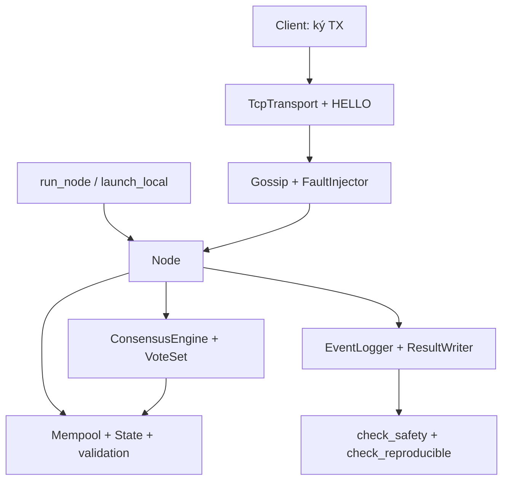

# Lab01 – Thiết kế và phân công

## Phạm vi

Blockchain L1 tối giản với validator set cố định, TCP giữa các process, peer tĩnh,
HELLO có chữ ký, gossip, execution và đồng thuận BFT. Bộ kiểm chứng gồm T1–T8;
xem [TEST_PLAN.md](TEST_PLAN.md) và phần reproduce trong [README](../README.md).

## Kiến trúc hiện tại

Mỗi validator là một process riêng. `network.peers` cấu hình địa chỉ; nếu không có,
CLI dùng `127.0.0.1:base_port+i`. Mỗi cặp validator giữ một kết nối TCP hai chiều.
Node chờ đủ peer có HELLO hợp lệ trước khi nạp tx, warmup và bắt đầu consensus.

## Phân công

| Vai trò | Phần chính | Kiểm chứng |
|---|---|---|
| A | models, encoding, crypto, config, logger, node, run_node, client, bộ chạy test và hướng dẫn reproduce | T1, T3 |
| B | execution, mempool, state, validation, faults, peer_limits, launch_local, safety và reproducibility checkers | T4, T5, T8 |
| C | TCP framing, HELLO, static peers, gossip | T2 và unit test network |
| D | consensus, VoteSet, locking, timeout, proposer rotation, Byzantine behaviors | T6, T7 |

## Giao tiếp giữa các phần

- Dữ liệu dùng các dataclass và enum trong `src/l1sim/models.py`.
- Canonical encoding và message ID dùng `encoding.py`; chữ ký dùng `crypto.py` và domain riêng.
- Engine nhận callback broadcast, timeout và finalize; không tự truy cập mạng hay đồng hồ.
- `Node` xác thực transaction, giữ block body và chuyển input tới engine.
- `Gossip` forward FLOOD khi handler chấp nhận; BODY_REQUEST/BODY gửi trực tiếp.
- `NodeNetwork` quản lý transport, peer connections, gossip, fault sender và đóng tài nguyên.
- Kết quả nằm ở `logs/results/<scenario>/`, event log ở `logs/events/<scenario>/`.

## Quy tắc tái lập và bàn giao

- Mọi node dùng cùng genesis, scenario và seed.
- Không dùng thứ tự set, randomness không seed hoặc timestamp trong dữ liệu hash/results.
- Mỗi voter được đếm tối đa một lần cho mỗi giá trị trong `(height, round, phase)`.
  Phiếu xung đột mới được ghi evidence và forward; bản lặp bị chặn.
- T8 so sánh results từng byte; event log có thể khác timestamp và thứ tự event.
- Chạy `python tests/run_tests.py` và `make lint` trước khi bàn giao.
- Quy trình branch, review và merge theo [CONTRIBUTING.md](../CONTRIBUTING.md).
